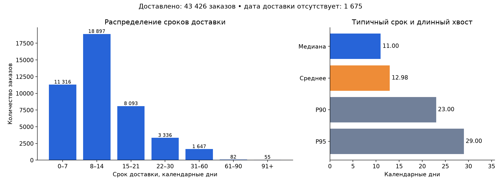

# Ozon Fresh: SQL и аналитические кейсы

Готовое решение тестового задания по данным заказов 2017 года: **9 SQL-запросов**, инфографика доставки, расследование отклонения продаж от прогноза и разбор графика двух групп.

- [Полное решение для сдачи](docs/Решение.md)
- [Подробный конспект для подготовки к защите](docs/Конспект.md)
- [Excel с результатами и диаграммами](outputs/Ozon_Fresh_решение.xlsx)
- [SQL-запросы](sql)
- [Результаты запросов в CSV](outputs)



| Показатель | Результат |
|---|---:|
| Заказы | 45 101 |
| Клиенты в июле | 3 947 |
| Средняя / медианная доставка | 12,98 / 11 дней |
| Уникальные SKU во II квартале | 4 762 |
| Средняя цена единицы во II квартале | 124,8714 ден. ед. |
| Седьмая категория | toys: 2 452 заказа, 5,4367% |
| bed_bath_table и/или computers_accessories | 7 120 заказов, 15,7868% |

## Воспроизведение

Python 3.10+ со встроенным SQLite 3.25+. Внешние зависимости для расчётов не нужны:

```sh
python scripts/run_analysis.py
```

Скрипт создаёт БД в памяти, загружает CSV с контролем первичных/внешних ключей, выполняет все девять запросов, обновляет CSV-результаты и sql_results.json. Независимые проверки на множествах Python и statistics сверяют основные метрики, перцентили, пересечение категорий и границы периода. При ошибке проверки скрипт завершится с исключением.

## Что находится в репозитории

`data/` — нормализованные первичные данные из трёх листов исходника; `sql/` — схема SQLite и девять решений; `scripts/` — воспроизводимый расчёт; `outputs/` — результаты запросов и итоговая Excel-книга; `docs/` — решение, конспект, инфографика и исходный график групп.

Вспомогательные столбцы Delivery time и Sales value в CSV не включены: срок рассчитан по датам orders, а Sales value в исходнике ошибочно умножает цену на номер позиции. Исходный XLSX не изменялся. Файл-источник: «Тестовое_к_Агате_сокращенный_вариант - Семён Яшин - Семён Яшин.xlsx». SHA-256: `2c8a11c51d5e6c945d111888d78da56d87f14f4538a0f5eb07de3059a556b1db`.

## Принятые определения

Заказы и клиентские ID считаются по orders, период — по дате покупки. Доставка — календарные дни только для известной даты получения, 1 675 пропусков показаны отдельно. Цена — на заказанную единицу, без доставки; валюта не задана. Знаменатель долей категорий — все 45 101 заказов, включая 522 без позиций. Популярность — уникальные заказы с категорией, ничьи — DENSE_RANK. По графику групп причинный эффект не доказан: pre-тренды расходятся.

Excel содержит сохранённые SQL-результаты, формулы долей и редактируемые диаграммы. Он не подключён автоматически к CSV; для новых данных необходимо повторить расчёт и обновить входные агрегаты книги. Основной исполняемый источник истины — SQL и run_analysis.py.

Материалы подготовлены по предоставленному учебному заданию; название проекта не означает, что набор отражает реальные продажи Ozon Fresh. Права на исходные данные и формулировки задания остаются у их правообладателей.
