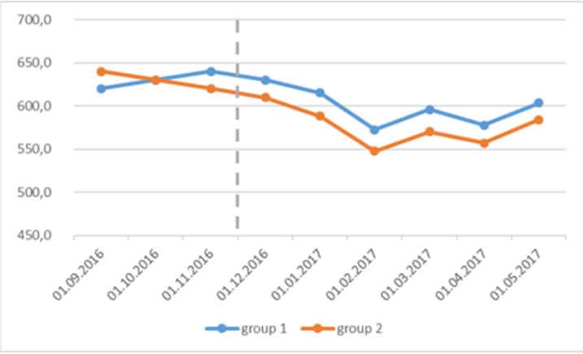

# Ozon Fresh — решение тестового задания

Период покупок: **05.01.2017–31.12.2017**. Источник — предоставленная Excel-книга; это учебный набор, его нельзя интерпретировать как показатели бизнеса Ozon Fresh. Валюта в книге не указана, поэтому цена приводится в денежных единицах источника.

## Краткие ответы на блок 1

| № | Вопрос | Ответ |
|---|---|---|
| 1 | Структура данных | orders: 45 101 заказ; order_items: 50 864 товарные единицы; products_category: 32 951 SKU |
| 2 | Заказы за весь период | **45 101** |
| 3 | Клиенты в июле | **3 947** различных customer_id |
| 4 | Средняя доставка | **12,9790 календарного дня**, по 43 426 заказам с датой доставки |
| 5 | Достаточно ли среднего | Нет: медиана 11, P90 = 23, P95 = 29, максимум 210 дней |
| 6 | Уникальные SKU во II квартале | **4 762** |
| 7 | Средняя цена заказанного товара во II квартале | **124,8714**; 10 403 товарные единицы |
| 8 | Седьмая категория по числу заказов | **toys**, 2 452 заказа, **5,4367%** всех заказов |
| 9 | bed_bath_table и/или computers_accessories | **7 120 заказов, 15,7868%**; обе категории одновременно: 1 заказ |

Заказ считается по `orders`, даже если у него нет позиций. Категория считается один раз на заказ. Доли категорий используют все 45 101 заказов в знаменателе. Периоды определяются датой покупки, а не доставки.

## Структура и качество источника

`orders`: order_id — ключ заказа; customer_id — доступный идентификатор клиента; purchase_timestamp — дата покупки; delivered_customer_date — дата получения клиентом. Связь с позициями 1:N.

`order_items`: ключ (order_id, order_item_id); product_id — SKU; seller_id — продавец; price — цена единицы; freight_value — доставка по позиции. Связь с каталогом N:1.

`products_category`: product_id — уникальный ключ; product_category_name — категория, которая может отсутствовать. Каталог содержит и товары, не заказанные в анализируемый период.

В исходном order_items есть вспомогательные столбцы `Delivery time` и `Sales value`. Они не являются надёжными первичными полями. `Sales value` содержит формулу price × order_item_id; порядковый номер позиции не является количеством. В расчётах используем price, а срок доставки заново определяем по двум датам orders. CSV содержит шесть первичных полей order_items, исключая эти два вспомогательных столбца; названия других таблиц и первичных полей сохранены.

Контроль качества: дубликатов ключей и потерянных связей товар–заказ/товар–каталог нет; 522 заказа без товарных позиций; 1 675 заказов без даты получения (3,7139%); 623 SKU в каталоге без категории, из них в заказах 921 товарная единица в 826 разных заказах. У 1 310 строк order_items отсутствует готовый Delivery time. Отрицательных сроков по датам orders нет. Нулевая доставка допустима при точности дат до календарного дня.

`customer_id` принимается как клиентский ключ по условию. Из одной книги нельзя доказать, что он стабилен для одного физического человека при повторных покупках: для такой проверки понадобился бы customer_unique_id или справочник клиентов. Ответ про июль относится к представленному customer_id.

Статус заказа и дата среза отсутствуют: нельзя уверенно называть все записи без даты получения отменёнными или просроченными. Средняя доставка описывает только заказы с известной датой получения, а не все потенциальные доставки.

## Доставка: вывод и инфографика


Среднее полезно как дополнительный показатель для оценки суммарной нагрузки и сравнения стабильных когорт. В качестве единственного описания клиентского опыта оно недостаточно: правый хвост до 210 дней повышает среднее относительно медианы 11 дней. Центральные 50% доставок занимают 7–16 дней; 90% укладываются в 23 дня, 95% — в 29 дней. Больше 30 дней доставлялись 1 784 заказа, или 4,1081% наблюдаемых доставок.

Рекомендую одновременно отслеживать медиану, P90/P95, среднее и долю без даты получения. Если доступна обещанная дата доставки, добавить долю доставок в срок; по текущим полям её посчитать нельзя. Экстремальные наблюдения не удаляю без подтверждения ошибки. Заказы декабря, доставленные в 2018 году, сохраняю в когорте покупок 2017 года.

## SQL-запросы

Диалект: **SQLite 3.25+** (оконные функции), выполняется через стандартный sqlite3 в Python. Даты CSV имеют ISO 8601, условия используют полуоткрытые интервалы [начало; начало следующего периода). Для PostgreSQL `julianday(end)-julianday(start)` заменяется вычитанием дат либо `EXTRACT(EPOCH FROM (end-start))/86400.0`; булевы суммы нужно заменить на `SUM(CASE WHEN ... THEN 1 ELSE 0 END)`. Основная проверенная версия — SQLite, запросы не заявлены как взаимозаменяемые между СУБД.

### 01_structure

```sql
-- SQLite. Одна строка orders = заказ, order_items = единица товара в заказе,
-- products_category = SKU и его категория. order_item_id не является количеством.
SELECT 'orders' AS table_name, COUNT(*) AS rows_count, COUNT(DISTINCT order_id) AS unique_keys FROM orders
UNION ALL SELECT 'order_items', COUNT(*), COUNT(DISTINCT order_id || ':' || order_item_id) FROM order_items
UNION ALL SELECT 'products_category', COUNT(*), COUNT(DISTINCT product_id) FROM products_category;
```

### 02_orders

```sql
-- Заказы за весь представленный период, в том числе без товарных позиций.
SELECT COUNT(*) AS orders_count, MIN(purchase_timestamp) AS first_purchase,
       MAX(purchase_timestamp) AS last_purchase FROM orders;
```

### 03_july_customers

```sql
-- customer_id трактуется как идентификатор клиента в предоставленной книге.
SELECT COUNT(DISTINCT customer_id) AS july_customers FROM orders
WHERE purchase_timestamp >= '2017-07-01' AND purchase_timestamp < '2017-08-01';
```

### 04_delivery

```sql
-- Когорта покупок 2017; доставки в 2018 сохраняются. NULL не равен нулю дней.
SELECT COUNT(*) AS all_orders, COUNT(delivered_customer_date) AS observed_deliveries,
       SUM(delivered_customer_date IS NULL) AS missing_deliveries,
       AVG(julianday(delivered_customer_date)-julianday(purchase_timestamp)) AS mean_days
FROM orders;
```

### 05_delivery_distribution

```sql
-- Перцентили: линейная интерполяция между соседними порядковыми статистиками.
WITH delivery AS (
 SELECT julianday(delivered_customer_date)-julianday(purchase_timestamp) AS days
 FROM orders WHERE delivered_customer_date IS NOT NULL
), ranked AS (
 SELECT days, ROW_NUMBER() OVER(ORDER BY days) AS rn, COUNT(*) OVER() AS n FROM delivery
), targets AS (
 SELECT 'P25' AS metric,0.25 AS p UNION ALL SELECT 'median',0.5
 UNION ALL SELECT 'P75',0.75 UNION ALL SELECT 'P90',0.9 UNION ALL SELECT 'P95',0.95
), positions AS (
 SELECT metric,1+p*(MAX(n)-1) AS pos FROM targets CROSS JOIN ranked GROUP BY metric,p
)
SELECT metric,
 MAX(CASE WHEN rn=CAST(pos AS INTEGER) THEN days END)
 + (pos-CAST(pos AS INTEGER)) * (
 COALESCE(MAX(CASE WHEN rn=CAST(pos AS INTEGER)+1 THEN days END),MAX(days))
 -MAX(CASE WHEN rn=CAST(pos AS INTEGER) THEN days END)) AS days
FROM positions CROSS JOIN ranked GROUP BY metric,pos
UNION ALL SELECT 'mean',AVG(days) FROM delivery
UNION ALL SELECT 'max',MAX(days) FROM delivery
UNION ALL SELECT 'min',MIN(days) FROM delivery;
```

### 06_q2_sku

```sql
SELECT COUNT(DISTINCT i.product_id) AS q2_unique_sku
FROM order_items i JOIN orders o ON o.order_id=i.order_id
WHERE o.purchase_timestamp >= '2017-04-01' AND o.purchase_timestamp < '2017-07-01';
```

### 07_q2_price

```sql
-- Средняя цена заказанной единицы товара, без freight_value.
-- Каждая строка позиции получает одинаковый вес; это не средний чек заказа.
SELECT COUNT(*) AS ordered_units, AVG(i.price) AS mean_unit_price,
       SUM(i.price) AS merchandise_value
FROM order_items i JOIN orders o ON o.order_id=i.order_id
WHERE o.purchase_timestamp >= '2017-04-01' AND o.purchase_timestamp < '2017-07-01';
```

### 08_seventh_category

```sql
-- Популярность = число уникальных заказов, содержащих категорию.
-- DENSE_RANK сохраняет все категории при равенстве популярности.
WITH counts AS (
 SELECT p.product_category_name,COUNT(DISTINCT i.order_id) AS category_orders
 FROM order_items i JOIN products_category p ON p.product_id=i.product_id
 WHERE p.product_category_name IS NOT NULL GROUP BY p.product_category_name
), ranked AS (
 SELECT *,DENSE_RANK() OVER(ORDER BY category_orders DESC) AS popularity_rank FROM counts
)
SELECT *,1.0*category_orders/(SELECT COUNT(*) FROM orders) AS share_all_orders
FROM ranked WHERE popularity_rank=7 ORDER BY product_category_name;
```

### 09_category_union

```sql
-- EXISTS исключает двойной счёт нескольких позиций и пересечение категорий.
WITH flags AS (
 SELECT o.order_id,
 EXISTS(SELECT 1 FROM order_items i JOIN products_category p ON p.product_id=i.product_id
 WHERE i.order_id=o.order_id AND p.product_category_name='bed_bath_table') AS bed,
 EXISTS(SELECT 1 FROM order_items i JOIN products_category p ON p.product_id=i.product_id
 WHERE i.order_id=o.order_id AND p.product_category_name='computers_accessories') AS computers
 FROM orders o
)
SELECT COUNT(*) AS all_orders,SUM(bed) AS bed_orders,SUM(computers) AS computer_orders,
 SUM(bed AND computers) AS both_orders,SUM(bed OR computers) AS either_orders,
 1.0*SUM(bed OR computers)/COUNT(*) AS share_either,
 1.0*SUM(bed AND computers)/COUNT(*) AS share_both FROM flags;
```

## Блок 2.1. Продажи на 15% ниже прогноза

### Уточнение метрики и проверка данных

Сначала фиксирую, что такое продажи: GMV, выручка после скидок и возвратов, штуки либо оплаченные/доставленные заказы. Уточняю период, часовой пояс, учёт НДС, доставку и используемую версию прогноза. Проверяю полноту месяца, задержку загрузки, совпадение статусов и каналов, поздние возвраты, дубли и изменения расчёта. Сравниваю с прогнозом, который был доступен до начала периода, чтобы исключить подмену версии.

Если факт на 15% ниже прогноза, F = 0,85 × P, дефицит P − F = 0,15 × P. Для возврата от текущего факта к прогнозу нужен рост 1/0,85 − 1 = **17,65%**. Эти проценты имеют разные знаменатели.

### Локализация отклонения

Строю таблицу по дням и сопоставимым дням недели, регионам, складам, категориям, каналам привлечения и новым/возвращающимся клиентам: план, факт, абсолютный разрыв и вклад в общий разрыв. Начинаю с сегментов, где абсолютные потери максимальны; высокий относительный провал маленького сегмента может почти не влиять на общий результат. Для аддитивных сегментов сумма разрывов должна сходиться с общим разрывом. Нельзя складывать отдельно потери по регионам и категориям: эти разрезы пересекаются.

### Дерево факторов и проверяемые гипотезы

Для GMV оформленных заказов: **сессии × конверсия сессии в заказ × средний чек**. Разрешаю несколько заказов в сессии: тогда использую заказы/сессии как интенсивность, а не вероятность конверсии. Для фактической выручки отдельно учитываю оплату, исполнение, отмены, возвраты и признание выручки. Средний чек = единиц на заказ × средняя цена единицы (на одной и той же базе). Не смешиваю метрики оформленных и доставленных заказов.

| Гипотеза | Как проверю | Какие данные нужны | Возможное действие после подтверждения |
|---|---|---|---|
| Снизился трафик или изменилось качество аудитории | Сессии, расходы, показы, CTR и заказы по каналам и дням против плана | Веб/апп-события, рекламные кабинеты, атрибуция, медиаплан | Исправить канал, перераспределить бюджет с учётом маржи |
| Упала конверсия | Воронка просмотр → корзина → checkout → оплата по устройствам, версиям и регионам | События, ошибки, платежные отказы, релизы, логи доступности | Устранить сбой/платёжный отказ; проверить эффект релиза |
| Товары отсутствовали | Доля времени in-stock, потерянные просмотры, доступность ключевых SKU, замены | Остатки во времени по складам, спрос, ассортимент и поставки | Восстановить запас и ключевой ассортимент |
| Не хватало слотов доставки | Доступные слоты, заполненность, обещанный срок, отказы на выборе слота | Логи слотов, мощности складов и курьеров, адресная доступность | Перераспределить мощности и слоты |
| Снизился чек или подешевела корзина | Цена, единицы/заказ, mix категорий, скидка и промо против плана | Позиции заказов, прайсы, скидки, календарь промо, прогноз mix | Скорректировать промо и ассортимент с оценкой маржи |
| Выросли отмены/возвраты | Оформленные → оплаченные → выполненные, причины и лаги возвратов | История статусов, причины, возвраты и дата признания | Устранить ведущую операционную причину |
| Меньше активных или повторных клиентов | Новые клиенты, retention, частота и траты по когортам | Стабильный ID, история заказов, CRM-кампании и экспозиция | Проверить удержание и релевантность коммуникаций |
| Сам прогноз завышен | Backtest по тем же горизонтам, систематическое смещение и интервалы | Архив прогнозов, календарь, история, допущения об акциях/росте | Перекалибровать модель и допущения |
| Сезонность, календарь или конкурент | Сопоставимые дни, праздники, цены конкурентов; затронутые сегменты | История нескольких лет, календарь, ценовой мониторинг | Уточнить сезонную поправку; проверить локальный ответ |

При наличии плановых факторов раскладываю разрыв последовательно. Для R = T × C × A: вклад трафика = (Tf − Tp)CpAp; вклад конверсии = Tf(Cf − Cp)Ap; вклад чека = TfCf(Af − Ap). Сумма точно равна Rf − Rp, но вклады зависят от порядка подстановки. Если это существенно, использую усреднение по всем порядкам (Shapley). Такое разложение описывает арифметику, а не доказывает причинность.

### Результат расследования

Отдаю короткую записку: общий разрыв в деньгах и процентах, главные сегменты и факторы с суммой вкладов, подтверждённые причины и альтернативы, действия с владельцами, ожидаемый эффект и способ проверки. Сначала устраняю дефект данных или сервиса, если он подтверждён; затем проверяю продуктовые гипотезы экспериментом. Интервал прогноза помогает понять, является ли отклонение необычным. Один факт «−15%» без дисперсии ошибок не доказывает поломку модели.

В книге нет плановых продаж, трафика, статусов, остатков и рекламных данных. Поэтому здесь приведён план расследования, а не выдуманная причина реального падения.

## Блок 2.2. Две группы и событие в декабре



По графику расходы обеих групп после декабря снижаются и затем частично восстанавливаются. В феврале виден общий минимум. Группа 1 после события тратит больше группы 2, но в ноябре до события она уже находилась выше. Поэтому сравнения только после события или только «до/после» группы 1 недостаточно.

Ключевой нюанс: до декабря разрыв между группами увеличивается — примерно −20 в сентябре, 0 в октябре, +20 в ноябре. После декабря он составляет примерно +20…+30. До события нет убедительного визуального подтверждения параллельных трендов. График допускает положительный относительный эффект, но также согласуется с продолжением предшествующего расхождения. По нему нельзя доказать ни положительное влияние, ни отсутствие влияния события. Общее падение тоже не доказывает отрицательный эффект: без события группа 1 могла бы упасть сильнее.

### Иллюстрация разности разностей

Считывание точек приблизительное, это **не исходные точные наблюдения**. Если взять ноябрь как pre и январь как post: группа 1 ≈640 → 615 (−25), группа 2 ≈620 → 590 (−30). DiD ≈ (−25) − (−30) = **+5 денежных единиц**. Это небольшой относительный разрыв, а не доказанный эффект.

Если взять среднее сентября–ноября как pre, средний разрыв ≈0; средний разрыв января–мая ≈24. Тогда иллюстративный DiD ≈+24. Сильная зависимость от окна сравнения показывает, почему нельзя выбирать удобный baseline и объявлять результат причинным. Декабрь исключаю как переходный месяц: точная дата события и длительность экспозиции неизвестны.

### Что запросить и как оценивать

Нужны расходы по клиенту и месяцу, включая нулевые траты; определение расходов, размер и состав групп; точная дата и тип события; правило попадания в группу; история до сентября, акции, регионы, категории, покупки/частота, изменения наблюдаемости и возвраты. Если на графике суммы по группам, их нельзя напрямую сравнивать без размеров групп. Если это средние только среди покупателей, исключение нулей может создать смещение отбора. Проверяю стабильные когорты и траты на всех клиентов группы.

Для DiD оцениваю `Y_it = α_i + λ_t + β × Treated_i × Post_t + ε_it` с фиксированными эффектами клиента и периода. Проверяю более длинные pre-тренды, event-study, placebo-даты, сопоставимость групп и отсутствие других групповых событий. Стандартные ошибки кластеризую на уровне назначения воздействия; при индивидуальном назначении — по клиенту. Если воздействие назначено всего двум агрегатным группам, стандартная кластерная статистика по двум кластерам ненадёжна — нужны другие единицы назначения/дизайн. Одно незначимое тестирование pre-trend не доказывает параллельность.

Если событие связано с высоким расходом или отбором активных клиентов, возможны обратная причинность и регрессия к среднему. Предпочтителен заранее рандомизированный A/B-тест с проверкой баланса, целевой метрикой и достаточным числом единиц рандомизации. Для наблюдательных данных сопоставление по pre-поведению помогает, но не устраняет все ненаблюдаемые различия. Отчёт должен содержать оценку эффекта, доверительный интервал, практическую значимость и ограничения идентификации.

**Вывод для сдачи:** у группы 1 после события выше траты, чем у группы 2; обе группы показывают общее падение. Причинный эффект события по представленному графику не установлен из-за расходящихся pre-трендов и отсутствия данных о дизайне и вариативности.
